# Dr. Roi Castrellon, DDS
**Healthcare Data Engineer & Applied AI Engineer**  
Miami, FL · US Permanent Resident · [LinkedIn](https://linkedin.com/in/roicast) · [roisasha@gmail.com](mailto:roisasha@gmail.com)

  
  

---

### Executive Profile
Clinician-turned-engineer combining a doctoral degree in clinical dentistry (DDS) with production software and data engineering. Experience architecting and operating multi-tenant healthcare data platforms, clinical claims ingestion pipelines, and air-gapped clinical AI systems.

- **Production Relational Scale:** Managed AWS RDS PostgreSQL architectures serving 24+ provider clients across 300+ governed relational tables and 1.8M+ clinical records.
- **Claims & Clinical Standardizations:** Ingested and categorized 180,000+ medical and dental billing claims into standardized AHRQ Clinical Classifications Software Refined (CCSR) categories with zero financial data loss.
- **Verification & Privacy Boundaries:** Constructed over 1,000 deterministic test gates enforcing strict HIPAA boundaries and zero-loss schemas before cloud deployments.

---

### Flagship Open-Source Engineering Systems

| Repository | Domain & Architecture | Core Stack | Live Verified CI & Demos |
| :--- | :--- | :--- | :--- |
| [**DrNemo-Caries-Foundry**](https://github.com/DrCiroSmith/DrNemo-Caries-Foundry) | **Computational Biophysics & Falsification:** Negative-control benchmark for cyclic peptide docking against *S. mutans* GtfB (3AIC) and human salivary amylase (1SMD) | AutoDock Vina · Vinardo · OpenMM Amber14 · WebGL |   |
| [**DentAssist**](https://github.com/DrCiroSmith/DentAssist) | **On-Device Clinical CDS:** Air-gapped multimodal diagnostic assistant running quantized MedGemma 4B locally on tablet/desktop | C++ FFI Bridge · MLC-LLM · Flutter · DoD 5220.22-M |   |
| [**internado-investigacion**](https://github.com/DrCiroSmith/internado-investigacion) | **Clinical Epidemiological Platform:** 156-week longitudinal surgical admission forecasting outperforming baseline models | SARIMA · Python 3.12 · MySQL 8.0 · Docker Compose |   |
| [**apollo-multiscreen-bridge**](https://github.com/DrCiroSmith/apollo-multiscreen-bridge) | **Low-Latency Systems Engineering:** Hardware-accelerated 144Hz NVENC video streaming with sub-10ms frame pacing | C++ / PowerShell · NVENC · VDD · P1 Preset |   |

---

### Core Technical Competencies

- **Data Engineering:** Python (Pandas, SQLAlchemy, psycopg2, NumPy), PostgreSQL (AWS RDS), SQL modeling, idempotent database migrations, multi-tenant isolation, ETL pipeline design, AHRQ CCSR claims mapping, Docker.
- **Computational Biophysics & Applied AI:** AutoDock Vina v1.2.7 & Vinardo docking, OpenMM Amber14/GBn2 steric minimization, on-device clinical LLMs (MLC-LLM, MedGemma, Ollama), econometric time-series modeling (ARIMA/SARIMA).
- **Security & Clinical Compliance:** HIPAA technical boundaries, air-gapped local inference, DoD 5220.22-M 3-pass memory sanitization, deterministic testing (pytest).

---

### Availability & Work Authorization
- **Status:** US Permanent Resident.
- **Target Roles:** Healthcare Data Engineer · Analytics Engineer · Applied AI Engineer.
- **Location:** Miami, FL (Available for full-time US Remote or South Florida on-site/hybrid positions).
