# Dr. Roi Castrellon, DDS
**Healthcare Data Engineer & Applied AI Engineer**  
Miami, FL · US Permanent Resident · [LinkedIn](https://linkedin.com/in/roicast) · [roisasha@gmail.com](mailto:roisasha@gmail.com)

**What I Am Looking For / Live Demos:** Healthcare Data Engineering, Applied AI, and Clinical Analytics (US-Remote or South FL) · [3D WebGL Studio](https://drcirosmith.github.io/DrNemo-Caries-Foundry/) · [Selected Systems](#selected-systems)

  
  

---

### Background
I practiced clinical dentistry (DDS) for six years before moving full-time into healthcare data engineering and local clinical AI. I build multi-client ingestion pipelines, claims reconciliation marts, and offline inference tools.

- **AWS RDS & PostgreSQL:** I run raw, clean, and reporting schemas serving 24+ provider clients across 300+ governed tables and 1.8M+ clinical and scheduling records.
- **Claims Mapping:** I ingested and mapped 180,000+ medical and dental billing claims into AHRQ CCSR categories with zero financial data loss.
- **Deployment Gates:** My pipeline runs over 1,000 pytest checks for schema contracts, SHA-256 deduplication, and HIPAA privacy boundaries before data hits production.

---

### Selected Systems

| Repository | Domain & Architecture | Core Stack | Live Verified CI & Demos |
| :--- | :--- | :--- | :--- |
| [**DrNemo-Caries-Foundry**](https://github.com/DrCiroSmith/DrNemo-Caries-Foundry) | **Computational Biophysics:** Negative-control cyclic peptide docking benchmark against *S. mutans* GtfB (3AIC) and human salivary amylase (1SMD) | AutoDock Vina · Vinardo · OpenMM Amber14 · WebGL |   |
| [**DentAssist**](https://github.com/DrCiroSmith/DentAssist) | **Offline Clinical CDS:** Air-gapped diagnostic assistant running quantized MedGemma 4B locally on tablet and desktop | C++ FFI Bridge · MLC-LLM · Flutter · DoD 5220.22-M |   |
| [**internado-investigacion**](https://github.com/DrCiroSmith/internado-investigacion) | **Surgical Forecasting:** 156-week longitudinal surgical admission forecast trained on hospital volume data | SARIMA · Python 3.12 · MySQL 8.0 · Docker Compose |   |
| [**apollo-multiscreen-bridge**](https://github.com/DrCiroSmith/apollo-multiscreen-bridge) | **Display Streaming:** Hardware-accelerated 144Hz NVENC video streaming with sub-10ms frame pacing | C++ / PowerShell · NVENC · VDD · P1 Preset |   |

---

### Stack

- **Data Engineering:** Python (pandas, SQLAlchemy, psycopg2, NumPy), PostgreSQL on AWS RDS, AWS S3, MySQL, idempotent migrations, AHRQ CCSR claims mapping, Power BI, DAX, Docker.
- **Applied AI & Biophysics:** MedGemma, MLC-LLM, Ollama, LiteLLM, ONNX Runtime, AutoDock Vina v1.2.7, Vinardo, OpenMM Amber14/GBn2, ARIMA/SARIMA time-series models.
- **Testing & Privacy:** pytest (1,000+ checks), HIPAA boundary and suppression controls, air-gapped local inference, DoD 5220.22-M 3-pass memory sanitization.

---

### Availability & Work Authorization
- **Status:** I am a US Permanent Resident and require no sponsorship.
- **Target Roles:** Healthcare Data Engineer, Applied AI Engineer, or Clinical Analytics Engineer.
- **Location:** Miami, FL (open to full-time US-Remote or South Florida hybrid/on-site roles).
